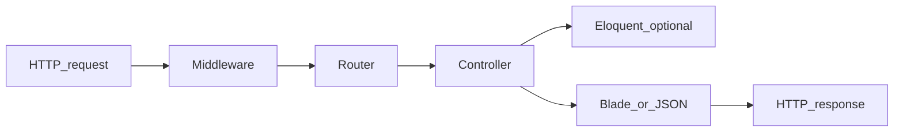

# Why Laravel next

> You've built a mini-router, talked to PDO, hashed passwords, and fought CSRF by hand. Laravel is what happens when someone productizes that checklist - and adds batteries.

## The honest pitch

Laravel is the default "get a PHP web app shipping" framework in a lot of shops in 2026. Job posts, starter kits, package ecosystem, docs that assume you're busy - it's the Vue-of-PHP vibe more than the Angular-of-PHP vibe (Symfony sits closer to that second pole).

I'm not saying it's "better" than Symfony. I'm saying: if you want to be productive fast after the [PHP tutorial](/lab/php-tutorial-for-fe-devs/), Laravel is a friendly next chapter.

## What you already know (mapped)

| [PHP tutorial](/lab/php-tutorial-for-fe-devs/) | Laravel name |
| --- | --- |
| Front controller `public/index.php` | same file, more bootstrapping |
| Mini router | `routes/web.php` / `routes/api.php` |
| Controllers as callables | Controller classes + invokables |
| `$_SESSION` + cookies | session driver + auth guards |
| PDO prepared statements | Eloquent / Query Builder (PDO underneath) |
| CSRF token dance | `@csrf` + middleware |
| `password_hash` | `Hash::make` / Eloquent casts |
| Composer + PSR-4 | same - `App\` → `app/` |

As you can see, the nouns change more than the physics.

## What Laravel adds that you'd invent anyway

- Validation objects (instead of hand-rolled `$errors` arrays)
- Migrations (schema in git)
- Mail, queues, notifications, filesystems - optional, but one API style
- Artisan CLI (`php artisan …`) - think of it as a project-local CLI router
- First-party auth scaffolding if you want it

## Mental model in one sentence

**A Laravel app is still request → middleware → route → controller → response.** Eloquent and Blade are helpers around that spine.

## Version note

This tutorial targets **Laravel 11 / 12-era** structure (slim `app/`, bootstrap in `bootstrap/app.php`). If a path differs by one minor version, trust `php artisan` and the official docs - the ideas stay.

If you're ready, next up is installing an app and poking the folders without fear.

Best,

-- ł.
