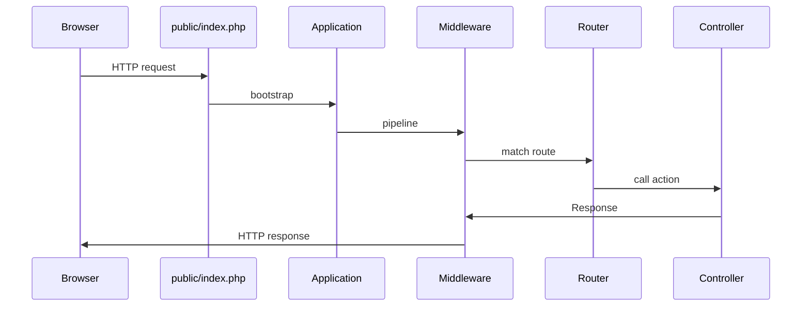

# Request lifecycle

> Same physics as the [PHP tutorial](/lab/php-tutorial-for-fe-devs/) - request in, response out. Laravel just runs a nicer pipeline before your code.

## The spine



Comments for the flow above:

- `public/index.php` still requires Composer autoload - nothing magical
- Middleware = the wrappers you sketched as stretch goals on the mini-router
- Router match is your `{name}` patterns grown up
- Response can be Blade HTML, JSON, redirect, file download…

## Compared to the mini-router

```php
// your toy version
$response = $router->dispatch($method, $path);
$response->send();
```

Laravel:

1. Creates an `Illuminate\Http\Request` from globals (`$_GET`, `$_SERVER`, …)
2. Sends it through middleware (session start, CSRF verify, auth, …)
3. Dispatches to a route action
4. Sends an `Illuminate\Http\Response` (or subclass)

You don't call `echo` and `header()` by hand anymore - return values / helpers do that.

## Where "magic" actually is

- **Service container** builds controller dependencies
- **Facades** resolve out of that container
- **Eloquent** lazy-loads relations if you aren't careful (we cover N+1 later)
- **Blade** compiles to plain PHP in `storage/framework/views`

Once you see it as boot → middleware → route → action, Laravel code reviews get much calmer.

Next: declaring routes without writing a regex engine.

Best,

-- ł.
