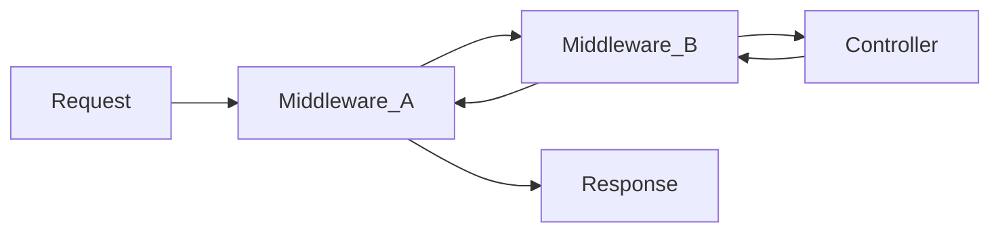

# Middleware

> Middleware is `function (req, next) => next(req)` energy - Express/Koa vibes on the PHP side. You've seen the idea; Laravel just registers it on routes.

## What it does

Wraps the request before (and sometimes after) the controller:

- Start session
- Verify CSRF
- Require auth
- Throttle API
- Set locale
- Log request timing



## Using middleware on routes

```php
<?php

Route::get('/dashboard', [DashboardController::class, 'index'])
    ->middleware(['auth']);

Route::middleware(['auth', 'verified'])->group(function () {
    Route::get('/settings', [SettingsController::class, 'edit']);
});
```

## Custom middleware (sketch)

```bash
php artisan make:middleware EnsureUserIsAdmin
```

```php
<?php

namespace App\Http\Middleware;

use Closure;
use Illuminate\Http\Request;
use Symfony\Component\HttpFoundation\Response;

class EnsureUserIsAdmin
{
    public function handle(Request $request, Closure $next): Response
    {
        if (! $request->user()?->is_admin) {
            abort(403);
        }

        return $next($request);
    }
}
```

Register it according to your Laravel version (alias in `bootstrap/app.php` or related config - check `php artisan make:middleware` output / docs). Then:

```php
Route::get('/admin', AdminController::class)->middleware('admin');
```

## Compared to FE

| Express / Nuxt server middleware | Laravel |
| --- | --- |
| `app.use(fn)` | global stack in bootstrap |
| per-route middleware | `->middleware([...])` |
| early `return res.status(401)` | `abort(401)` / redirect |

If something "randomly" redirects to login - it's usually the `auth` middleware, not ghost witches. `route:list` shows middleware attached to routes.

Best,

-- ł.
